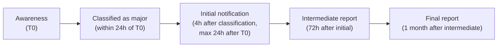
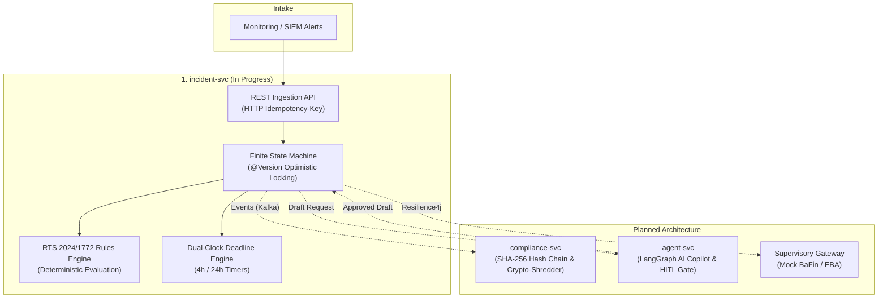
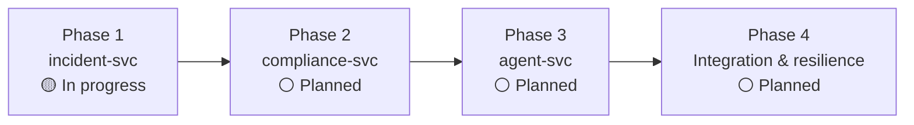

<div align="center">


<a href="https://github.com/Abhijit-Birle/dora-incident-reporting">
  
</a>

<br />


<p>
  <a href="#-the-problem">Problem</a> ·
  <a href="#-the-idea">Idea</a> ·
  <a href="#-architecture">Architecture</a> ·
  <a href="#-key-design-decisions">Decisions</a> ·
  <a href="#-whats-built-today">Status</a> ·
  <a href="#-run-it-locally">Run it</a>
</p>

</div>

---

## 🎯 At a glance

> **For recruiters and interviewers:** a backend system modeled on real EU financial regulation. It shows event-driven design, data integrity, privacy-by-design, and safe use of AI in a regulated setting. The design is complete and documented. The core service is under active development.

| | |
|---|---|
| **Domain** | RegTech / financial services (EU DORA, APRA CPS 230) |
| **What it does** | Classifies ICT incidents, tracks legal reporting deadlines, produces an audit trail |
| **Core stack** | Java 21 · Spring Boot 3 · Spring Data JPA · Flyway · PostgreSQL 16 · Docker |
| **Planned** | Kafka · Python / LangGraph · KMS · Resilience4j |
| **Status** | Architecture spec done · `incident-svc` foundation built · rules engine, FSM, deadlines in progress |
| **Best place to start** | [`design/ARCHITECTURE.md`](design/ARCHITECTURE.md) |

## 🧨 The problem

Since January 2025, EU financial entities must follow the **Digital Operational Resilience Act (DORA)**. When a serious IT incident happens, they must:

1. **Classify** it against fixed criteria (is it a *major* incident?)
2. **Report** to the regulator on a strict schedule
3. **Prove** later what was decided, by whom, and when

Doing this by hand under pressure is slow and error-prone. Missing a deadline or misclassifying an incident has real regulatory consequences.



<sub>Regulatory timeline for context. The exact rules live in the implementing standards linked below.</sub>

## 💡 The idea

Use automation where it is safe, and keep humans and proofs where it matters.

<table>
  <tr>
    <td width="25%" align="center"><h3>⚖️</h3><b>Deterministic rules decide</b><br /><sub>Classification is plain, testable Java. No AI in the decision path.</sub></td>
    <td width="25%" align="center"><h3>🤖</h3><b>Advisory AI drafts</b><br /><sub>An AI agent drafts report text. It never files anything.</sub></td>
    <td width="25%" align="center"><h3>🧑‍⚖️</h3><b>Humans approve</b><br /><sub>A human-in-the-loop gate stands before every submission.</sub></td>
    <td width="25%" align="center"><h3>🔗</h3><b>The log proves it</b><br /><sub>A SHA-256 hash-chained ledger makes tampering detectable.</sub></td>
  </tr>
</table>

The platform enforces a hard boundary between **deterministic compliance logic** (Java) and **probabilistic advisory AI** (Python / LangGraph), so regulatory decisions stay reproducible and audit-traceable.

**Regulations covered**

- **EU DORA**, Regulation (EU) 2022/2554, Articles 17 to 23
- **Commission Delegated Regulation (EU) 2024/1772**, major incident classification criteria
- **Implementing standards (EU) 2025/301 and 2025/302**, staged regulatory reporting
- **APRA CPS 230**, operational risk management (Australia)

## 🏗️ Architecture



<table>
  <tr>
    <th>Service</th><th>Responsibility</th><th>Tech</th><th>Status</th>
  </tr>
  <tr>
    <td><code>incident-svc</code></td>
    <td>Intake, classification, state machine, deadline clocks</td>
    <td>Java 21, Spring Boot 3, JPA, Flyway</td>
    <td>🟡 In progress</td>
  </tr>
  <tr>
    <td><code>compliance-svc</code></td>
    <td>Tamper-evident audit ledger, verifier, GDPR crypto-shredding</td>
    <td>Java, KMS envelope encryption</td>
    <td>⚪ Planned</td>
  </tr>
  <tr>
    <td><code>agent-svc</code></td>
    <td>AI drafting with PII sanitization, RAG citations, human approval</td>
    <td>Python, LangGraph</td>
    <td>⚪ Planned</td>
  </tr>
  <tr>
    <td>Gateway</td>
    <td>Submission to a mock supervisor (BaFin / EBA) with circuit breaking</td>
    <td>Resilience4j</td>
    <td>⚪ Planned</td>
  </tr>
</table>

Full specs, state matrices, event contracts, and threat models: [`design/ARCHITECTURE.md`](design/ARCHITECTURE.md).

## 🧠 Key design decisions

Each decision is a trade-off. These are the ones worth discussing.

| Decision | Why | Trade-off |
|---|---|---|
| **Rules in Java, AI only advisory** | Regulators need decisions that are explainable and reproducible. Same input, same output. | Less flexible than an AI classifier. Rules must be maintained by hand. |
| **Optimistic locking (`@Version`)** | Several actors can touch one incident. Conflicts are rare, so avoid holding database locks. | Callers must handle retries on conflict. |
| **Idempotency keys on intake** | Monitoring tools retry. A duplicate alert must never create a duplicate incident. | Extra table and key lifecycle to manage. |
| **Single-writer hash-chained audit ledger** | Each entry includes the hash of the previous one, so edits are detectable. | One writer limits throughput. Verification needs a background worker. |
| **Crypto-shredding for GDPR Art. 17** | An immutable log and the right to erasure conflict. Encrypt personal data, then delete the key to "erase" it. | Needs key management and careful envelope encryption design. |
| **Human-in-the-loop before submission** | AI text is a draft. A person owns the filing. | Slower than full automation, on purpose. |
| **Event-driven (Kafka) between services** | Services stay decoupled and the audit service sees every change. | Eventual consistency and more moving parts. |

## ✅ What's built today



**Phase 1 checklist (4 of 8 done)**

- [x] Architecture specification: services, event flows, state matrices, threat models
- [x] Service scaffolding: Java 21, Spring Boot 3.x, Spring Data JPA, Flyway
- [x] Database schema (`V1__init.sql`)
  - `incident.incident`: statutory deadline fields (`awareness_at`, `classified_at`, `classification_deadline`) and `@Version` support
  - `incident.idempotency_key`: request deduplication
- [x] Local infrastructure: Docker Compose with PostgreSQL 16
- [ ] Deterministic rules engine for the 7 criteria of RTS 2024/1772
- [ ] Finite state machine with optimistic locking
- [ ] 4h / 24h dual-clock deadline engine
- [ ] Idempotent REST intake: `POST /api/v1/incidents`

<details>
<summary><b>Later phases in detail</b></summary>

- **Phase 2, `compliance-svc`:** single-writer SHA-256 hash-chained ledger, periodic verifier worker, GDPR Art. 17 crypto-shredding via KMS envelope encryption
- **Phase 3, `agent-svc`:** stateful LangGraph workflow, deterministic PII sanitization, RAG legal-citation matching, human-in-the-loop `interrupt()` approval gates
- **Phase 4, integration and resilience:** mock NCA (BaFin / EBA) endpoint, Resilience4j circuit breaking, chaos fault injection

</details>

## 🧩 What this demonstrates

| Skill | Where it shows up |
|---|---|
| **Backend engineering** | Java 21, Spring Boot 3, JPA, schema migrations with Flyway |
| **Distributed systems** | Event-driven services, idempotency, optimistic concurrency |
| **Data integrity and security** | Hash-chained ledger, threat modeling, crypto-shredding |
| **Privacy and compliance** | GDPR Art. 17, DORA, audit-by-design |
| **Applied AI, safely** | Advisory-only agent, PII sanitization, human approval gates |
| **Resilience** | Circuit breakers and chaos testing (planned) |
| **Engineering process** | Design-first: spec, threat model, then code. Tested with Testcontainers and JUnit 5. |

> Items marked planned are designed and documented, not yet implemented.

<details>
<summary><b>💬 Questions worth asking me</b></summary>

- Why keep AI out of the classification decision, and where is it allowed in?
- How does a hash-chained ledger coexist with the right to erasure?
- What happens when two operators update the same incident at once?
- How would you test a 4h / 24h clock deterministically?
- What would break first at 100x alert volume?

</details>

## 📁 Repository layout

```
dora-incident-reporting/
├── design/                   # Architecture and system design specs
│   └── ARCHITECTURE.md
├── incident-svc/             # Core incident service (Java 21 / Spring Boot 3)
│   ├── src/main/java/
│   └── src/main/resources/
│       ├── application.yaml
│       └── db/migration/     # Flyway migrations (V1__init.sql)
├── deploy/
│   └── docker-compose.yml    # PostgreSQL 16
└── README.md
```

## 🚀 Run it locally

**Prerequisites:** Java 21, Docker with Compose, Maven (or the included `./mvnw`).

```bash
# 1. Start PostgreSQL (port 5432, database dora_db)
cd deploy
docker compose up -d

# 2. Build and run incident-svc
cd ../incident-svc
./mvnw clean compile
./mvnw spring-boot:run
```

Flyway applies the migrations to the local database on startup.

## 🧰 Tech stack


-231F20?style=flat-square&logo=apachekafka&logoColor=white)
-3776AB?style=flat-square&logo=python&logoColor=white)
-1C3C3C?style=flat-square)

## 👤 About the author

I'm **Abhijit Birle**, a backend engineer working on payments and fintech systems. I built this to go deep on a real regulatory problem, from reading the rules to designing the system that enforces them.

[GitHub](https://github.com/Abhijit-Birle) · <!-- add LinkedIn / email here -->

## 📄 License

Apache-2.0

<div align="center">
  <sub>Design first, then code. ⭐ a star is always welcome.</sub>
</div>
