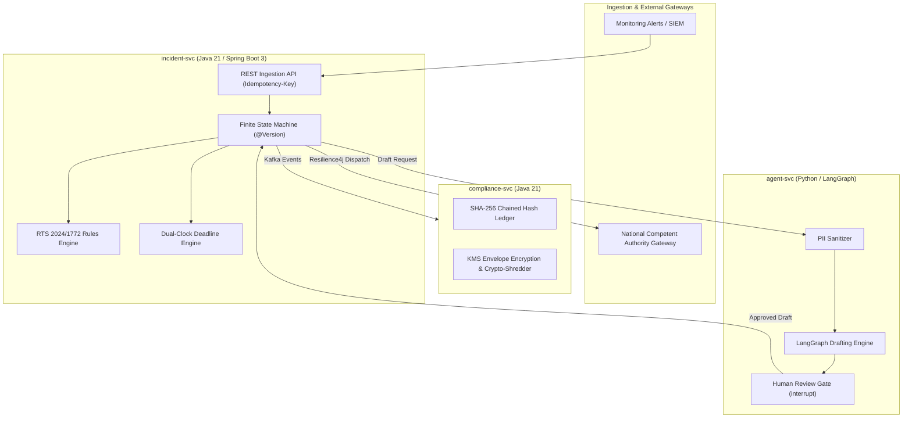

# DORA Auditor

> **Automated ICT Incident Classification & Regulatory Reporting Platform**  
> *Deterministic rules decide. Advisory AI drafts. Humans approve. The cryptographic audit log proves it.*

---

## Overview

**DORA Auditor** is an event-driven distributed platform designed to automate major ICT incident classification, statutory deadline tracking, and compliance reporting in accordance with:
* **EU DORA (Regulation (EU) 2022/2554)** — Articles 17 to 23
* **Commission Delegated Regulation (EU) 2024/1772** (Major Incident Classification Criteria)
* **Implementing Standards (EU 2025/301 & EU 2025/302)** (Staged Reporting Standards)
* **Australian APRA CPS 230** (Operational Risk Management)

The platform is architected to eliminate non-deterministic risks in regulatory reporting by establishing a strict boundary between **deterministic compliance logic** (Java) and **probabilistic generative assistance** (Python / LangGraph).

---

## Architectural Highlights

* **Deterministic Rules Engine & State Machine (`incident-svc`)**:
  - Implements the 7 regulatory criteria and threshold formulas of EU 2024/1772 in pure Java.
  - Manages incident lifecycles using an orchestrated finite state machine with JPA `@Version` optimistic concurrency control.
  - Computes and enforces statutory dual clocks (4-hour classification deadline / 24-hour awareness window).
* **Cryptographic Audit Ledger & GDPR Crypto-Shredding (`compliance-svc`)**:
  - Maintains an immutable, tamper-evident SHA-256 hash-chained ledger (`H_n = SHA-256(H_{n-1} || Payload_n)`).
  - Implements envelope encryption with KMS-managed per-subject Data Encryption Keys (DEKs) for GDPR Art. 17 right-to-erasure compliance without breaking audit hash integrity.
* **Advisory AI Copilot & Human Gate (`agent-svc`)**:
  - Pre-scrubs all logs and payloads for sensitive PII before model exposure.
  - Uses stateful LangGraph workflows with `interrupt()` gates requiring authenticated human approval before regulatory dispatch.
  - Retrieves regulatory citations from a ChromaDB vector store containing official DORA RTS/ITS standards.
* **Resilient Event-Driven Messaging**:
  - Event streaming via Apache Kafka with idempotent consumers and Resilience4j circuit breakers for external supervisory gateway failover.

---

## System Architecture



Detailed architectural specifications, event schemas, state matrices, and threat models can be found in [design/ARCHITECTURE.md](design/ARCHITECTURE.md).

---

## Repository Structure

```
dora-auditor/
├── design/                   # Microservices architecture & system design specs
│   └── ARCHITECTURE.md
├── incident-svc/             # Core ingestion, classification engine & state machine
│   ├── src/main/java/        # Java 21 / Spring Boot 3 application code
│   └── src/main/resources/   # Flyway migrations (db/migration) and YAML config
├── deploy/                   # Local infrastructure (Docker Compose)
│   └── docker-compose.yml
└── README.md
```

---

## Tech Stack

* **Languages**: Java 21 (Virtual Threads), Python 3.11+
* **Frameworks**: Spring Boot 3.x, Spring Data JPA, Flyway, FastAPI
* **Messaging & Data**: Apache Kafka, PostgreSQL 16, ChromaDB
* **Orchestration & AI**: LangGraph, LangChain
* **Reliability & Testing**: Resilience4j, Testcontainers, JUnit 5, Chaos Testing

---

## License

Apache-2.0
