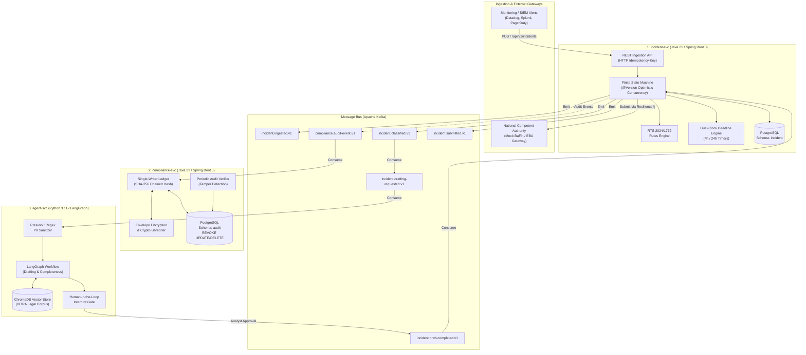
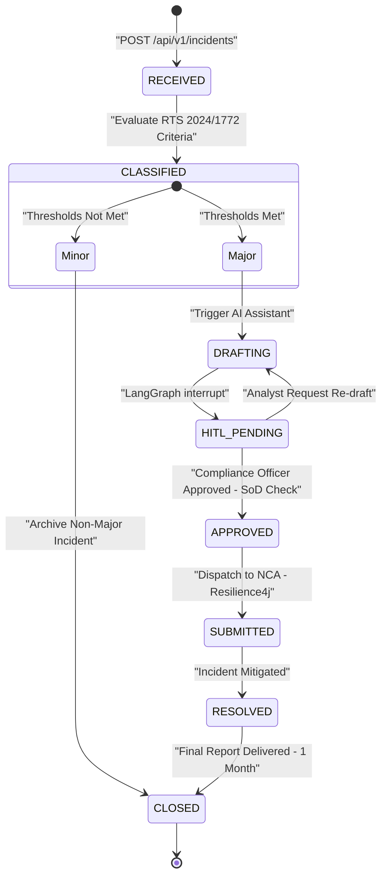
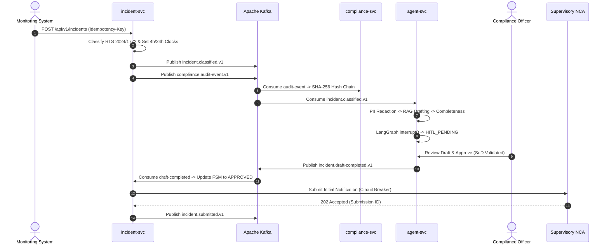
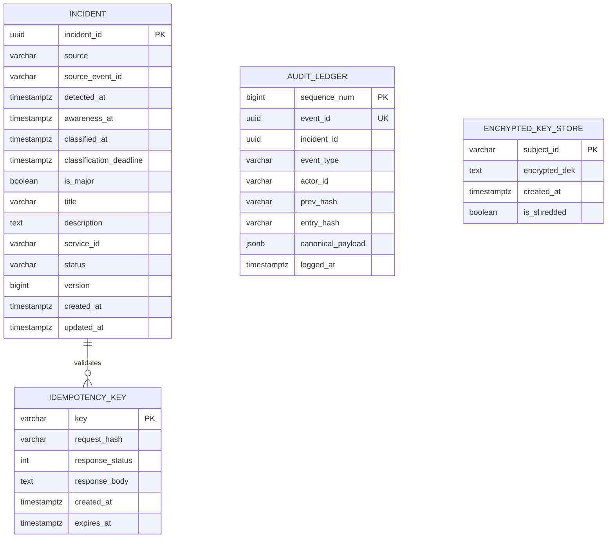

# DORA Auditor — Microservices Architecture & System Design

> **Target Standard**: EU DORA (Regulation 2022/2554), RTS (EU 2024/1772), ITS (EU 2025/301, 302), and AU APRA CPS 230  
> **Core Motto**: *Rules decide. AI explains and drafts. Humans approve. The audit log proves it.*  
> **Runtime Stack**: Java 21 (Virtual Threads), Spring Boot 3.x, Apache Kafka, PostgreSQL 16, Python 3.11+ (LangGraph, FastAPI)

---

## 1. Architectural Principles & Boundaries

The architecture enforces a strict distinction between **deterministic legal logic** and **probabilistic generative assistance**:

```
+--------------------------------------------------------------------------------------------------+
|                                    ARCHITECTURAL BOUNDARIES                                      |
+--------------------------------------------------------------------------------------------------+
|  DETERMINISTIC PLANE (Java 21 / Spring Boot 3)                                                    |
|  - Incident classification formula (RTS EU 2024/1772 Criteria & Thresholds)                      |
|  - Statutory dual-deadline countdown timers (4-hour classification / 24-hour awareness)          |
|  - Orchestrated Finite State Machine (FSM) with JPA @Version optimistic locking                  |
|  - Cryptographic SHA-256 hash-chained audit ledger (Single-writer serialization)                 |
|  - KMS envelope encryption & GDPR Art. 17 crypto-shredding                                      |
+--------------------------------------------------------------------------------------------------+
                                        ▲                     │
                            Strict JSON │                     │ Asynchronous
                               Contracts│                     │ Event Stream
                                        │                     ▼
+--------------------------------------------------------------------------------------------------+
|  PROBABILISTIC / ADVISORY PLANE (Python / LangGraph / ChromaDB)                                   |
|  - Unstructured log parsing and chronological event timeline summarization                       |
|  - Regulatory draft preparation against standard EBA/BaFin templates                            |
|  - RAG legal citation retrieval over 300+ pages of DORA RTS/ITS specifications                   |
|  - Human-in-the-Loop (HITL) review checkpoint (LangGraph stateful interrupt)                    |
+--------------------------------------------------------------------------------------------------+
```

---

## 2. High-Level Microservices Topology

The platform consists of three decoupled microservices communicating asynchronously over Kafka, with shared persistence on PostgreSQL (using strict per-service schema isolation):



---

## 3. Microservice Specifications

### 3.1 `incident-svc` (Core Orchestrator & Rule Engine)
* **Responsibility**: Ingestion, deduplication, regulatory threshold classification, state machine orchestration, deadline tracking, and NCA dispatch.
* **Key Components**:
  1. **Idempotent Ingestion Filter**: Deduplicates incoming HTTP requests using `Idempotency-Key` headers stored with SHA-256 payload hashes.
  2. **RTS (EU 2024/1772) Rules Engine**: Deterministic evaluator for 7 regulatory criteria:
     - Critical services affected
     - Clients/transactions impacted ($> 100,000$ or $> 10\%$ of user base)
     - Economic impact ($> \text{€}100,000$ or $10\%$ of tier 1 capital)
     - Geographic spread ($\ge 2$ EU Member States)
     - Data integrity loss
     - Duration ($> 2$ hours of critical downtime)
     - Reputational impact / media coverage
  3. **Finite State Machine**: Manages the linear lifecycle using JPA `@Version` to guarantee zero state anomalies.
  4. **Dual-Clock Deadline Scheduler**: Tracks:
     - **Initial Notification**: Within 4 hours of classification, but $\le 24$ hours from initial awareness.
     - **Intermediate Report**: Within 72 hours of initial notification.
     - **Final Report**: Within 1 month from resolution.
  5. **Resilient NCA Dispatcher**: Resilience4j Circuit Breaker and Retry mechanism with fallback dead-lettering for regulatory endpoint downtime.

### 3.2 `compliance-svc` (Cryptographic Security & GDPR Shredder)
* **Responsibility**: Immutable, tamper-evident audit ledger and GDPR-compliant crypto-shredding.
* **Key Components**:
  1. **Single-Writer Hash Chain**:
     - Serializes all state changes into an append-only table.
     - Computes:
       $$\text{Hash}_n = \text{SHA-256}\left(\text{Hash}_{n-1} \parallel \text{CanonicalJSON}(\text{Payload}_n)\right)$$
     - Dedicated PostgreSQL role with `REVOKE UPDATE, DELETE, TRUNCATE` on `audit.audit_ledger`.
  2. **Automated Verifier Job**:
     - Background verification worker traversing the hash chain to immediately flag any raw database corruption or tampering.
  3. **Envelope Encryption & Crypto-Shredder**:
     - Encrypts PII/subject-identifiable metadata using a per-subject Data Encryption Key (DEK).
     - DEKs are encrypted using a Key Encryption Key (KEK) via KMS/Vault.
     - **GDPR Art. 17 Erasure**: Shreds (deletes) the DEK. The ciphertext becomes permanently undecryptable pseudorandom noise without breaking the cryptographic audit hash chain.
  4. **Separation of Duties (SoD)**:
     - Cryptographically verifies that the user who drafted an incident report cannot approve or submit it.

### 3.3 `agent-svc` (AI Regulatory Copilot & Human Gate)
* **Responsibility**: Unstructured narrative generation, legal citation matching, and human-in-the-loop gating.
* **Key Components**:
  1. **Deterministic PII Sanitization**:
     - Scans incident logs and descriptions for IBANs, names, emails, and IP addresses before invoking LLM models.
  2. **Stateful LangGraph Workflow**:
     - 5-stage graph: `pii_redaction` $\rightarrow$ `log_summarization` $\rightarrow$ `report_drafting` $\rightarrow$ `completeness_check` $\rightarrow$ `hitl_review`.
     - Uses LangGraph `interrupt()` to hold execution in `hitl_review` until an authorized compliance officer approves via the UI/API.
  3. **RAG Legal Retrieval**:
     - ChromaDB collection indexed with DORA RTS/ITS regulatory articles.
     - Evaluated against a BM25 baseline for citation precision and recall.

---

## 4. Finite State Machine (FSM) & Concurrency Architecture

The incident lifecycle follows an immutable forward-only state machine to prevent race conditions across distributed microservices:



### 4.1 State Transition Matrix

| Current State | Target State | Triggering Event | Auth Role | Pre-conditions |
| :--- | :--- | :--- | :--- | :--- |
| `RECEIVED` | `CLASSIFIED` | `RTS_EVALUATED` | System | Idempotent intake confirmed |
| `CLASSIFIED` | `DRAFTING` | `AI_DRAFT_REQUESTED` | System | `is_major == true` |
| `CLASSIFIED` | `CLOSED` | `ARCHIVE_NON_MAJOR` | System | `is_major == false` |
| `DRAFTING` | `HITL_PENDING` | `DRAFT_READY` | System / AI | Completeness validation passed |
| `HITL_PENDING` | `DRAFTING` | `REJECTED_RETRY` | Compliance Reviewer | Rejection feedback provided |
| `HITL_PENDING` | `APPROVED` | `HUMAN_APPROVED` | Compliance Officer | **SoD**: Approver $\ne$ Drafter |
| `APPROVED` | `SUBMITTED` | `NCA_ACCEPTED` | System / Dispatcher | Circuit breaker healthy; NCA returns 200/202 |
| `SUBMITTED` | `RESOLVED` | `INCIDENT_RESOLVED` | Incident Commander | Recovery verified; intermediate reports filed |
| `RESOLVED` | `CLOSED` | `FINAL_REPORT_FILED`| Compliance Officer | Final reporting submitted to NCA |

### 4.2 Concurrency Control via JPA `@Version`

When an analyst approves an incident while a background Kafka consumer processes an update, database-level race conditions are prevented:

```
Thread A (Analyst Approval)        Thread B (Background Classifier)
          │                                      │
          ├───────── Read version = 1 ───────────┤
          │                                      │
     Applies Edits                          Evaluates Criteria
          │                                      │
 UPDATE ... WHERE version = 1           UPDATE ... WHERE version = 1
   -> Succeeded (version = 2)             -> Fails (OptimisticLockException)
          │                                      │
          ▼                                      ▼
     Commits TX                             Catches OptimisticLockException
                                            Reloads version = 2 and re-evaluates
```

---

## 5. Kafka Event Bus & Topic Contracts

Every event published to Kafka adheres to standard CloudEvents specification envelopes with OpenTelemetry distributed trace baggage.



### 5.1 Kafka Topic Directory

| Topic Name | Key | Partitioning Strategy | Payload Contract |
| :--- | :--- | :--- | :--- |
| `incident.ingested.v1` | `incident_id` | Partition by `incident_id` | Incident source, raw metrics, timestamp |
| `incident.classified.v1` | `incident_id` | Partition by `incident_id` | Severity (`MAJOR`/`MINOR`), criteria met, deadlines |
| `incident.drafting-requested.v1` | `incident_id` | Partition by `incident_id` | Classified incident payload, sanitized logs ref |
| `incident.draft-completed.v1` | `incident_id` | Partition by `incident_id` | Formatted draft, legal citations, review metadata |
| `incident.submitted.v1` | `incident_id` | Partition by `incident_id` | NCA receipt number, submission payload, timestamp |
| `compliance.audit-event.v1` | `entity_id` | Partition by `entity_id` | Action type, actor, payload snapshot, previous state |

---

## 6. Cryptographic Security & GDPR Crypto-Shredding

### 6.1 Tamper-Evident SHA-256 Ledger
* Each audit entry contains:
  - `sequence_number` (Monotonically increasing `BIGINT`)
  - `prev_hash` (Hex-encoded SHA-256 of entry $n-1$)
  - `payload_canonical_json` (Sorted keys, whitespace-stripped UTF-8 JSON)
  - `entry_hash` = $\text{SHA-256}(\text{prev\_hash} \parallel \text{payload\_canonical\_json} \parallel \text{timestamp})$
* The genesis block has `prev_hash` = `0000000000000000000000000000000000000000000000000000000000000000`.

### 6.2 Envelope Encryption & Crypto-Shredding Lifecycle

```
[Subject/Customer PII] ──► Encrypt with DEK ──► [Ciphertext Stored in Audit / DB]
                             ▲
                             │ Wrapped by KEK
                       [KMS / Vault KEK]

GDPR Art. 17 Erasure Request:
  1. Call KMS: Delete / Destroy DEK for Subject_123.
  2. The Ciphertext in the database becomes irrecoverable mathematical noise.
  3. The SHA-256 hash chain remains 100% valid because the stored bytes did not change.
  4. Both GDPR (Right to Erasure) and DORA (Audit Retention) are simultaneously fulfilled.
```

---

## 7. Database Schemas & Data Isolation



---

## 8. Failure Modes & Resilience Strategies

| Failure Mode | Blast Radius | Mitigation Strategy |
| :--- | :--- | :--- |
| **NCA Gateway 503 / Timeout** | Submission delayed | Resilience4j Circuit Breaker opens; retry topic backoff; statutory alert logged. |
| **Kafka Broker Downtime** | Event delivery stalled | In-flight REST requests rejected with 503; producer retries with backoff; client retries via `Idempotency-Key`. |
| **LangGraph / LLM Latency Spike** | Report draft delayed | Decoupled from `incident-svc`; classification and statutory clocks continue uninterrupted. |
| **Audit Ledger DB Corruption** | Regulatory audit risk | Automated verifier scans chain every 15 min; triggers high-priority alert if hash mismatch is discovered. |
| **Concurrent Edit Collisions** | Risk of state drift | JPA `@Version` optimistic locking triggers `OptimisticLockException`; automatic retry with state reload. |

